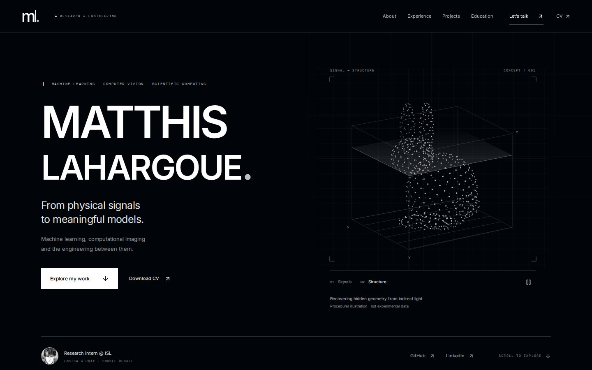
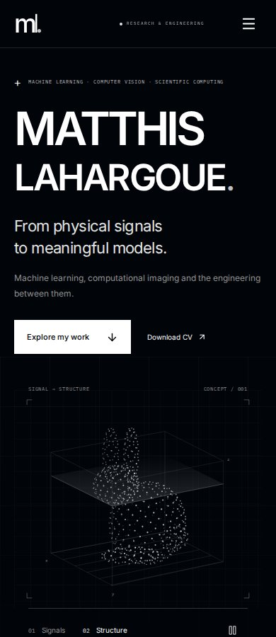
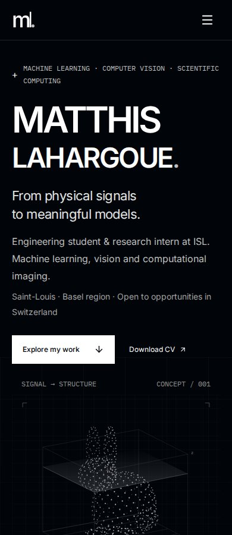
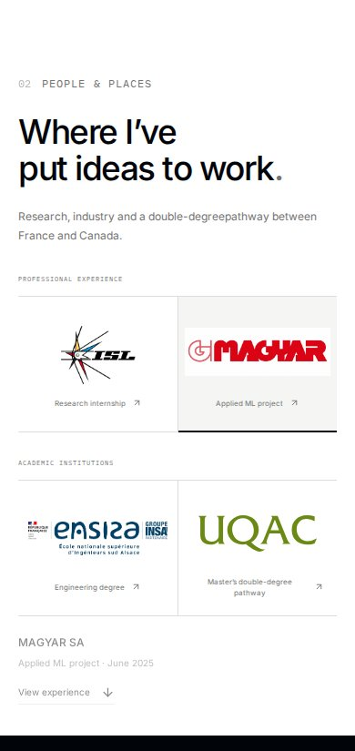
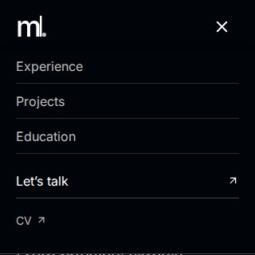

# Portfolio V2 — finition et vérification du 17 octobre 2026

Branche de revue : `feat/portfolio-v2-finish-20261017`, issue de `7520e2004be5365df8b2173b2bec6b07120bdbc0` (PR #4). Les six commits V2 existants sont conservés. Cette branche réunit leur travail et les corrections ci-dessous ; elle est proposée à `master`, sans fusion ni déploiement.

La production vérifiée reste `master` à `366061dec18649dffb4fbe2b79ac2e923da98888`. Le [workflow Pages de ce commit](https://github.com/matla91/matla91.github.io/actions/runs/38929989304) a réussi. Les workflows de PR ne possèdent aucun chemin de déploiement.

L’[audit priorisé initial](README.md) contient la comparaison visuelle avec Martin Dallinger, la revue des cinq projets, les corrections de typographie, logos, transitions, hiérarchie et performance, ainsi que les captures avant/après. Ses mesures sont datées et rattachées à leur commit ; elles ne sont pas présentées comme des mesures de cette nouvelle finition.

## Deux défauts supplémentaires corrigés

| Priorité | Déclencheur et défaut | Correction | Non-régression |
|---|---|---|---|
| P1 | Un lien d’un bloc encore transparent reçoit le focus avant la notification de l’IntersectionObserver. Son contenu et son indicateur de focus peuvent rester invisibles pendant l’apparition. | `:focus-within` affiche le bloc immédiatement ; le gestionnaire de focus le marque définitivement révélé, sans rejouer l’animation au départ du focus. | Test avec observateur différé ; contrôle Chromium avec mouvement actif, opacité et transition mesurées dans la même tâche que le focus. |
| P1 | Le menu mobile est plus haut qu’un écran court. Le lien CV peut sortir de la fenêtre, et le menu reste superposé après que Tab atteint le contenu. | Hauteur limitée à la fenêtre dynamique, défilement interne et fermeture quand le focus quitte les liens. Le focus reste sur sa prochaine cible. | Test d’interaction et contrôles à 390 × 360 et 320 × 320 ; captures comparatives et visibilité effective du lien CV. |

Aucune nouvelle décoration, technologie ou affirmation scientifique. Fond `#010409`, sections claires, figures monochromes et couleurs officielles des logos conservés.

## Contrôles locaux

`npm run check` réussit sous Node v24.19.0 : **18 tests Vitest**, TypeScript strict, builds Vite client et SSR, 7 pages pré-rendues et 9 redirections. Le contrôle de distribution valide **16 fichiers HTML et 165 références locales** (ressources, liens, ancres), les textes alternatifs et les régions contrôlées. Le script navigateur passe la vérification de syntaxe ; `git diff --check` réussit.

JavaScript client : **273 434 octets bruts**, environ **84,38 ko gzip**, contre 406 864 octets sur la production de référence (environ −33 %). Les variations temporelles Lighthouse restent à distinguer de cette réduction de ressources.

## Vérification des sources publiques

Relus le 17 octobre via GitHub : README du profil, README de Basel Tram Air, README de l’étude CNN et les comptes rendus publics MAGYAR et sentiment distribué.

- MAGYAR : les ~1 000 images, l’équipe de deux, le prototype hors ligne et 78 % macro F1 figurent dans le compte rendu public. Le portfolio conserve leur attribution et la limite de reproductibilité.
- CNN : le dépôt rapporte ~62,7 % pour la baseline et les réseaux. Le portfolio distingue ces observations de l’hypothèse de fuite temporelle et ne reprend pas comme prouvée l’accusation du README contre le papier initial.
- Basel : 262 cellules, données de décembre 2019 à mars 2020 et démo publique. Les observations restent historiques.
- Sentiment : 0,854 est attribué au compte rendu public ; 1,6 M désigne les données d’entraînement, sans validation indépendante des expériences.
- ISL : seuls le sujet général, le statut et le périmètre d’ingénierie déjà publics sont présentés. Aucun résultat inédit ou document confidentiel n’a été utilisé.

## Rendu et performances

Le [workflow du code vérifié](https://github.com/matla91/matla91.github.io/actions/runs/39013526979) a réussi sur `09047a085689c5a8a97aa72be1c7049b7f9f3436`. Les [rapports et leur provenance](final/provenance.json) sont conservés dans `final/`, avec 16 captures retenues parmi les 86 du workflow. L’artefact complet et ses rapports Lighthouse HTML sont disponibles jusqu’au 16 novembre 2026. L’intégrité de l’archive téléchargée a été vérifiée par SHA-256.

Le protocole contrôle l’accueil et les cinq projets aux largeurs CSS **1440, 1280, 768, 390 et 320** : 30 combinaisons sur la V2 et 30 mesures de référence. Aucun débordement horizontal détecté sur la V2, ni texte HTML visible sous 12 px. Les quatre logos chargent sans filtre de désaturation et restent dans leurs cadres. **35 scans axe sans violation détectée** sur les pages et les états MAGYAR ouverts ; les états des autres panneaux, leurs liens, la fermeture et le retour de focus sont aussi testés. Les vérifications laissées `incomplete` restent manuelles.

Le zoom **natif Chromium à 200 %** est vérifié sur les six pages : largeur intérieure 720 CSS px depuis une fenêtre 1440 px, `devicePixelRatio` de 2, aucun débordement. Une vérification de reflow à 720 × 450 est conservée séparément. Signals / Structure, pause et mouvements réduits, navigation mobile, accordéons, retour aux projets, lien projet suivant, CV PDF et route 404 passent également.

Le test de focus avant apparition confirme un bloc initialement en attente, puis une opacité de 1 et une transition de 0 s immédiatement au focus ; il reste révélé après le départ du focus. Les menus sur écrans courts sont défilables et contenus : bas à 359 px pour 390 × 360 et à 319 px pour 320 × 320, contre 428 px sur la référence. Le CV est visible dans le panneau et Tab passe au contenu en fermant le menu, sans déplacement artificiel du focus. Voir [browser.json](final/browser.json).

Les captures des premiers tests ont aussi révélé que le répertoire d’artefacts pouvait inclure des preuves versionnées d’une campagne antérieure. La CI utilise désormais un répertoire temporaire neuf et chaque rapport automatique porte le SHA réellement contrôlé. Cette correction concerne uniquement la traçabilité ; les sources de l’application sont identiques à celles du code vérifié ci-dessus.

### Captures comparatives

| Vue et dimensions CSS | Avant | Après |
|---|---|---|
| Hero · 1440 × 900 |  |  |
| Hero · 390 × 900 |  |  |
| Organisations · largeur 390 px |  |  |
| Menu · 320 × 320, CV au focus |  |  |

[Organisations à 320 px](final/captures/after-organizations-320.jpg) · [Focus avant apparition](final/captures/after-keyboard-reveal.jpg) · [Zoom natif à 200 %](final/captures/after-native-zoom-200-home.jpg) · [Étude MAGYAR](final/captures/after-industrial-computer-vision-1440.jpg).

### Mesures Lighthouse

Médianes de **trois exécutions** par profil et version, soit douze mesures sur le même runner Ubuntu 24.04, Node v24.21.0, Chromium 156.0.8078.4 et Lighthouse 13.5.0. Build de production servi en HTTP local, gzip pour le texte et cache 600 s ; profil navigateur neuf à chaque exécution. La compression et le cache ont aussi été vérifiés sur les en-têtes de la production. Les deux versions sont mesurées dans le même job.

| Profil | Performance /100, avant → après | LCP, avant → après | CLS, avant → après | TBT, avant → après |
|---|---|---|---|---|
| Mobile | 96 → **98** | 2,488 → **2,331 s** | 0,0036 → **0** | 26,5 → **19,5 ms** |
| Ordinateur | 100 → **100** | 0,563 → **0,529 s** | 0,0012 → **0** | 0 → **0 ms** |

Les catégories accessibilité, bonnes pratiques et SEO ont une médiane de 100 pour les deux profils. Ces scores ne constituent pas une certification WCAG. [Résultats individuels et paramètres exacts](final/lighthouse.json).

- Mobile : 412 × 823 CSS px ; simulation, RTT 150 ms, débit 1 638,4 Kbit/s, CPU ×4.
- Ordinateur : 1 350 × 940 CSS px ; simulation, RTT 40 ms, débit 10 240 Kbit/s, CPU ×1.

Les gains modestes de temps restent soumis à la variabilité du laboratoire. La réduction du JavaScript d’environ 33 % est une différence de ressources directement vérifiable.

### Liens externes

Douze URL distinctes répondent HTTP 200, dont le site publié, le CV PDF, la démo Basel et tous les dépôts et comptes rendus liés. LinkedIn répond 405 en HEAD et 999 en GET au client automatisé ; sa disponibilité n’est pas certifiée et ces refus ne prouvent pas un lien cassé. [Détail des requêtes](final/link-check.json).

## Limites explicites

Le navigateur Work a expiré lors de la tentative d’ouverture du site public le 17 octobre. Les captures Work comparatives du 16 octobre et les preuves CI précédentes sont conservées avec leur provenance. La référence a aussi été relue comme page publique le 17 octobre ; son rendu mobile et ses animations n’ont pas pu être réexaminés dans Work pendant cette finition.

Les rendus de la branche sont contrôlés en Chromium de CI, pas sur téléphone physique. Safari/iOS, Firefox, lecteurs d’écran, ergonomie tactile réelle et fatigue visuelle restent des vérifications humaines. Les contrastes SVG laissés `incomplete` par axe ne sont pas assimilés à des succès. Aucune certification WCAG exhaustive n’est revendiquée.

Lighthouse est un test de laboratoire sur build local, avec trois exécutions par profil et version, et ne mesure pas les utilisateurs GitHub Pages. INP terrain indisponible ; TBT ne constitue pas une mesure d’INP. Les chiffres privés des projets ne sont pas indépendamment vérifiables et n’ont pas été recherchés.
