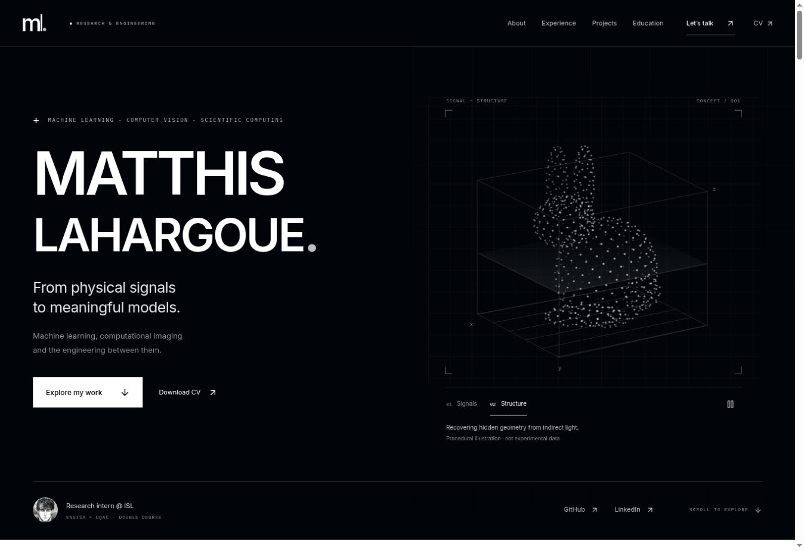
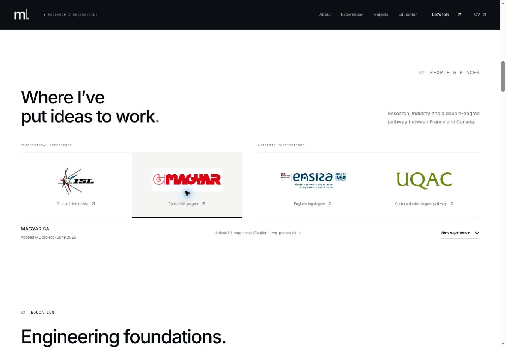

# Portfolio V2 — audit et finition

Audit du 16 octobre 2026. Production vérifiée sur `master`, commit `366061dec18649dffb4fbe2b79ac2e923da98888` (PR MAGYAR intégrée). Travail isolé sur `feat/portfolio-v2-polish`. Le workflow Pages ne déploie pas une PR.

## Constats prioritaires et corrections

| Priorité | Constat sur la version déployée | Correction et bénéfice |
|---|---|---|
| P1 | Nombreuses légendes, dates, technologies et contrôles de 6 à 11 px ; lecture difficile sur grand écran | Plancher CSS de 12 px ; corps courants de 14 à 16 px ; textes scientifiques de 16 px. Tailles conservées sur téléphone. |
| P1 | Identité scientifique claire, mais statut et intérêt pour la Suisse éloignés du titre | Statut étudiant / stage ISL, région de Bâle et intérêt pour les opportunités suisses visibles dans le Hero. |
| P1 | Contributions et niveau de preuve dispersés dans les études de cas | Encadré « My contribution / Evidence & scope » au début de chacune des cinq pages. Les limites restent détaillées plus bas. |
| P1 | MAGYAR avait suscité une confusion de cache après remplacement | Les quatre logos passent par Vite : URL portant une empreinte de contenu, actualisée à chaque remplacement. Fichiers officiels et couleurs inchangés. |
| P1 | Animation d’opacité du nuage prioritaire sur le fondu : le nuage pouvait rester présent en mode Signals | Séparation du groupe animé et du groupe de transition. Mise en pause hors écran ou dans un onglet masqué ; pause manuelle conservée. |
| P2 | Panneau d’organisation peu lisible, description masquée sous 900 px, hauteur variable à la sélection | Description visible à toute largeur ; panneaux superposés dans une grille réservant la hauteur nécessaire ; boutons de fermeture, Échap et retour du focus au logo. |
| P2 | Groupe de quatre logos trop dense à la largeur tablette | Deux groupes clairement identifiés, empilés sous 900 px ; rôle lisible et contrôle + indiquant l’ouverture. |
| P2 | Expérience professionnelle placée après les diplômes | Expériences placées juste après les organisations, avant la formation. |
| P2 | Fermeture des expériences abrupte | Transition native de hauteur avec `::details-content` lorsque supportée ; repli natif fonctionnel ailleurs ; réduction du mouvement respectée. |
| P2 | Titres secondaires gris foncé dans les sections noires | Gris plus clair pour les titres atténués sur fond sombre ; focus visible et contrôles utiles de 44 px. |
| P2 | Bibliothèque d’animation complète pour un seul panneau | Transitions CSS ciblées ; suppression de Motion. JavaScript client : 406 864 → 273 132 octets bruts (−33 %), gzip 128,45 → 84,31 ko. Aucun changement de framework. |
| P2 | Police principale découverte par la feuille de style | Préchargement de la seule police Inter latine, auto-hébergée. |

## Comparaison visuelle

Les deux sites publics ont été examinés dans le navigateur Work. La référence rend les rôles et les preuves très vite identifiables, avec des liens directs vers les expériences. Ses logos sont distincts et ses contenus développés progressivement. Ces principes motivent les corrections ci-dessus. Les couleurs, images, polices et créations de la référence ne sont pas utilisées dans le portfolio.

Le portfolio conserve son fond `#010409`, ses sections blanches, son avatar, ses illustrations scientifiques monochromes et ses grilles. Les couleurs sont réservées aux marques officielles.

Les captures Chromium comparables, prises aux largeurs CSS exactes, sont produites dans `generated/captures/`. Elles utilisent la version déployée ci-dessus comme « before », puis le build de la PR comme « after ». Réduction du mouvement activée pour stabiliser les captures ; animation testée séparément avec mouvement actif.

## Revue des cinq projets

| Projet | Travail et preuve mis en avant | Limites conservées |
|---|---|---|
| NLOS / ISL | Simulation, préparation des données, entraînement et évaluation ; rôle de stagiaire explicitement indiqué | Illustration conceptuelle, aucun résultat inédit, code, protocole ou jeu de données institutionnel. Lien institutionnel, pas de faux dépôt public. |
| MAGYAR | Contribution au pipeline dans une équipe de deux ; ~1 000 images et prototype hors ligne | 78 % macro F1 attribué au compte rendu public, non vérifiable indépendamment ; aucune affirmation de déploiement industriel. |
| Reproductibilité CNN | Réimplémentation, séparation temporelle, normalisation et comparaison à une baseline | ~62,7 % concerne la baseline et les CNN étudiés. Pas de supériorité inventée, ni preuve d’erreur du papier initial. Limites des fenêtres T+30 explicites. |
| Basel Tram Air | Carte et timelapse, 262 cellules spatiales, démo et dépôt publics | Mesures de décembre 2019 à mars 2020 ; approximation spatiale et couverture limitée, aucune assimilation à une mesure actuelle. |
| Sentiment distribué | Représentations, MinHash LSH, voisins et PySpark sur Calcul Québec | 1,6 M désigne les tweets d’entraînement du dataset ; 0,854 est auto-déclaré, pas une évaluation publique reproductible. |

Les schémas existants reçoivent des légendes explicatives (pipeline, séparation temporelle, flux distribué), lisibles aussi lorsque leurs libellés SVG deviennent petits sur téléphone. Les technologies et liens publics ont été conservés ; aucun résultat ajouté.

## Vérification et reproductibilité

- `npm run check` : 16 tests Vitest, compilation TypeScript, client + SSR Vite, pré-rendu de 7 pages et 9 redirections ; 165 liens, ressources et ancres internes vérifiés.
- `npm run test:browser` : cinq largeurs (1440, 1280, 768, 390, 320), accueil et cinq pages de projets ; débordements, taille minimale des textes HTML, chargement et couleurs des logos, axe WCAG 2.2 AA, panneaux, clavier, navigation, CV et routes directes. Rapport complet dans `generated/browser.json`.
- `npm run audit:performance` : Lighthouse sur build de production local, trois mesures mobiles et trois desktop pour chaque version. Conditions détaillées avec chaque résultat dans `generated/lighthouse.json`. Rapports HTML/JSON complets dans l’artefact Actions `portfolio-v2-audit`.
- La CI enregistre ses captures et résultats sur la branche V2 uniquement, jamais sur `master`. Cette écriture ne modifie que les preuves d’audit. Aucun déploiement.

## Limites à distinguer d’une validation

L’aperçu local de Work a échoué dans le superviseur (`bwrap: Can't mount proc ... Operation not permitted`). Les captures des sites publics sont celles de Work ; les contrôles du code modifié se font dans Chromium en CI, pas sur des appareils physiques.

Le test de reflow utilise 720 × 450 CSS px, équivalent en surface à un écran 1440 × 900 au zoom 200 %. Il ne valide pas le zoom natif du navigateur. Le zoom réel à 200 %, Safari/iOS, Firefox, lecteurs d’écran et utilisation tactile sur appareil réel restent à vérifier manuellement. Axe ne constitue pas une certification WCAG : pertinence des textes alternatifs, compréhension des descriptions, fatigue visuelle et ordre de lecture nécessitent un jugement humain.

Lighthouse mesure un environnement de laboratoire, pas l’hébergement GitHub Pages ni les utilisateurs réels. INP terrain non disponible ; TBT ne doit pas être présenté comme INP. Les résultats privés ISL et les métriques propriétaires ne sont pas vérifiables et ne sont pas nécessaires à cet audit.
