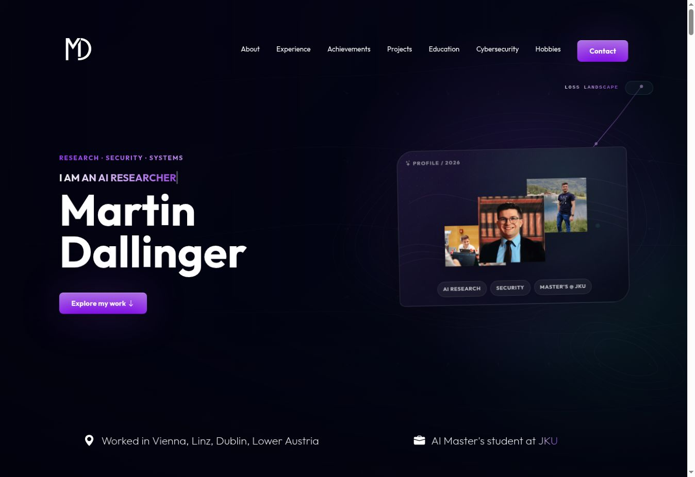
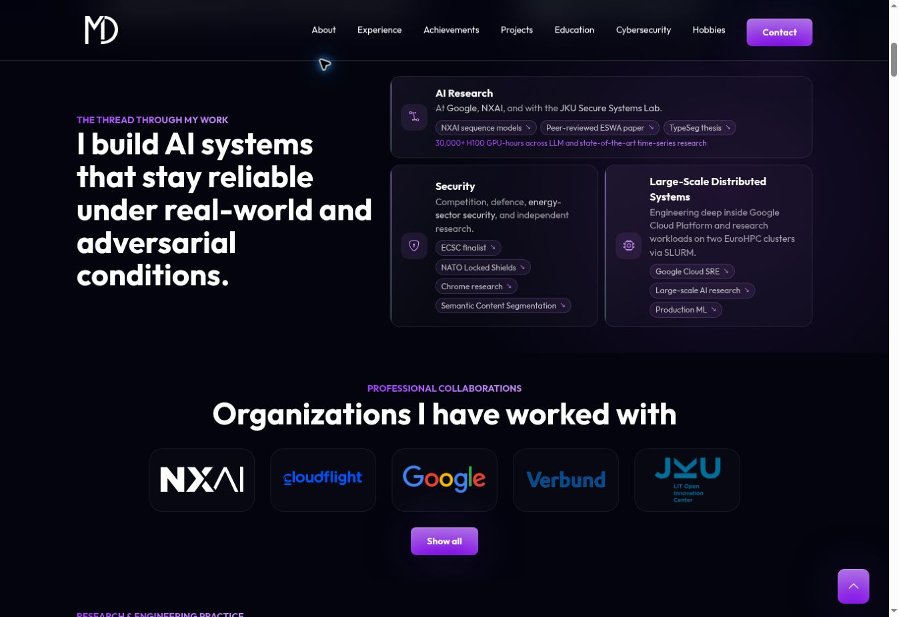
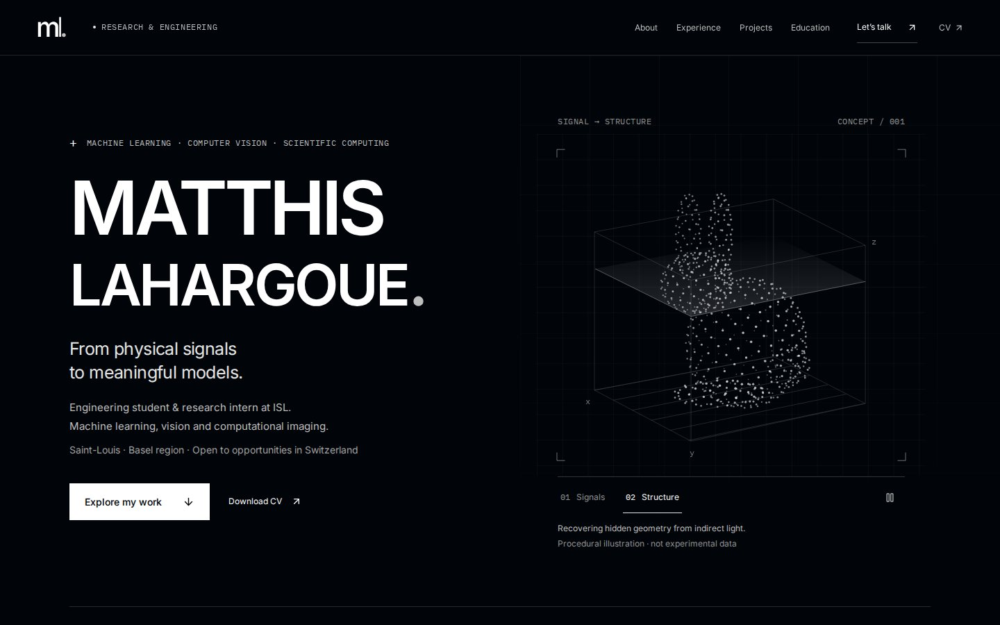
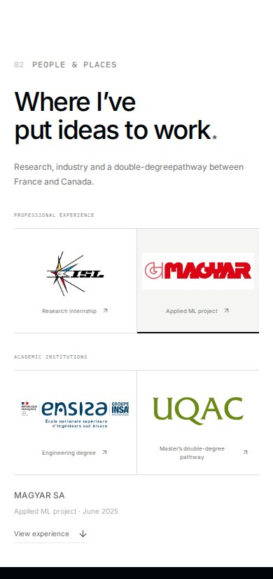
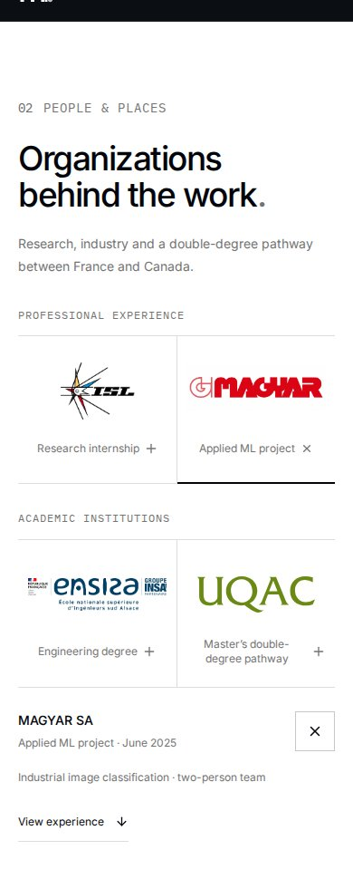
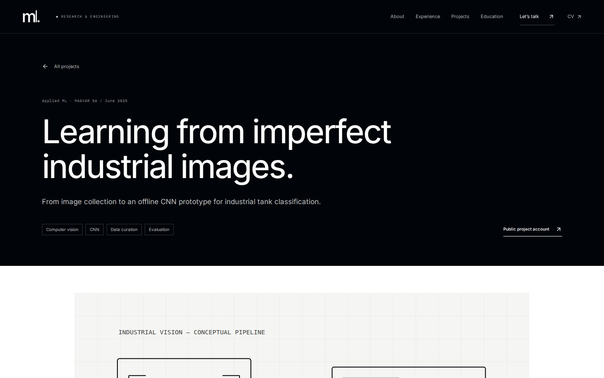
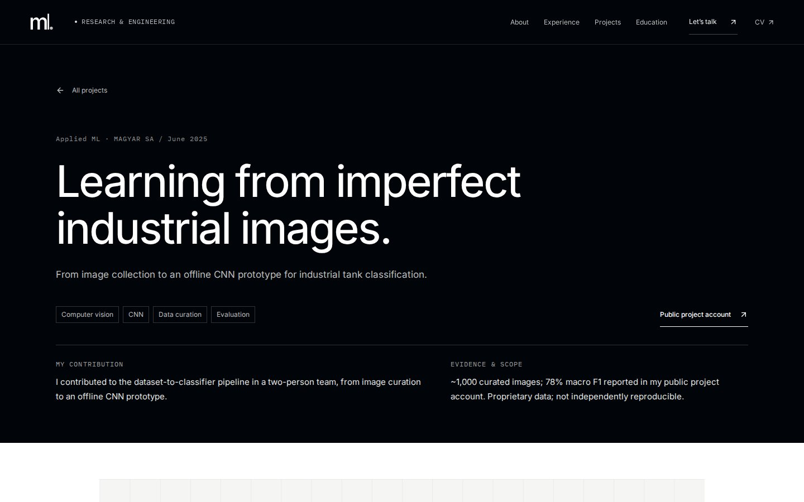

# Portfolio V2 — audit et finition

Audit du 16 octobre 2026. Production vérifiée sur `master`, commit `366061dec18649dffb4fbe2b79ac2e923da98888` (PR MAGYAR intégrée). Le [dernier workflow de production](https://github.com/matla91/matla91.github.io/actions/runs/38929989304) est réussi sur ce SHA. Travail isolé sur `feat/portfolio-v2-polish`. Le workflow Pages ne déploie pas une PR.

## Constats prioritaires et corrections

| Priorité | Constat sur la version déployée | Correction et bénéfice |
|---|---|---|
| P1 | Nombreuses légendes, dates, technologies et contrôles de 6 à 11 px ; lecture difficile sur grand écran | Plancher CSS de 12 px ; corps courants de 14 à 16 px ; textes scientifiques de 16 px. Tailles conservées sur téléphone. |
| P1 | Identité scientifique claire, mais statut et intérêt pour la Suisse éloignés du titre | Statut étudiant / stage ISL, région de Bâle et intérêt pour les opportunités suisses visibles dans le Hero. |
| P1 | Contributions et niveau de preuve dispersés dans les études de cas | Encadré « My contribution / Evidence & scope » au début de chacune des cinq pages. Les limites restent détaillées plus bas. |
| P1 | MAGYAR avait suscité une confusion de cache après remplacement | Les quatre logos passent par Vite : URL portant une empreinte de contenu, actualisée à chaque remplacement. Fichiers officiels et couleurs inchangés. |
| P1 | Animation d’opacité du nuage prioritaire sur le fondu : le nuage pouvait rester présent en mode Signals | Séparation du groupe animé et du groupe de transition. Mise en pause hors écran ou dans un onglet masqué ; pause manuelle conservée. |
| P2 | Panneau d’organisation peu lisible, description masquée sous 900 px, hauteur variable à la sélection | Description visible à toute largeur ; panneaux superposés dans une grille réservant la hauteur nécessaire ; boutons de fermeture, Échap et retour du focus au logo. |
| P2 | Groupe de quatre logos trop dense à la largeur tablette | Deux groupes clairement identifiés, empilés sous 900 px ; rôle lisible et contrôle + indiquant l’ouverture. |
| P2 | Expérience professionnelle placée après les diplômes | Expériences placées juste après les organisations, avant la formation. |
| P2 | Fermeture des expériences abrupte | Transition native de hauteur avec `::details-content` lorsque supportée ; repli natif fonctionnel ailleurs ; réduction du mouvement respectée. |
| P1 | Contraste insuffisant du numéro Organizations (2,49:1) et de la légende Scope sur fond gris (4,34:1), détecté par axe | Suppression de l’opacité héritée et gris plus sombre sur fond clair ; les scans après correction ne signalent plus ces violations. |
| P2 | Titres secondaires gris foncé dans les sections noires | Gris plus clair pour les titres atténués sur fond sombre ; focus visible et contrôles utiles de 44 px. |
| P2 | Bibliothèque d’animation complète pour un seul panneau | Transitions CSS ciblées ; suppression de Motion. JavaScript client : 406 864 → 273 132 octets bruts (−33 %), gzip 128,45 → 84,31 ko. Aucun changement de framework. |
| P2 | Petit débordement de la métrique NLOS à 320 px après agrandissement des textes | Retour à la ligne de la paire indicateur / légende, vérifié à 320 px. |
| P2 | Légendes du Hero trop serrées au zoom 200 % | Espacement minimum et retour à la ligne sans réduire la police. |
| P2 | Police principale découverte par la feuille de style | Préchargement de la seule police Inter latine, auto-hébergée. |

## Comparaison visuelle

Les deux sites publics ont été examinés dans le navigateur Work. La référence rend les rôles et les preuves très vite identifiables, avec des liens directs vers les expériences. Ses logos sont distincts et ses contenus développés progressivement. Ces principes motivent les corrections ci-dessus. Les couleurs, images, polices et créations de la référence ne sont pas utilisées dans le portfolio.

Captures de la référence : audit comparatif uniquement, hors ressources du portfolio

Source : [martin-dallinger.me](https://martin-dallinger.me/), observé dans Work le 16 octobre 2026.

Le [README GitHub public](https://github.com/matla91/matla91) a été relu pour confirmer le statut, les domaines et la direction visuelle. Le portfolio conserve son fond `#010409`, ses sections blanches, son avatar, ses illustrations scientifiques monochromes et ses grilles. Les couleurs sont réservées aux marques officielles.

Les captures Chromium comparables, prises aux largeurs CSS exactes, sont conservées dans `generated/captures/` (sélection ci-dessous). Le code vérifié est `5bc44814371e9e13b637aca0167eb12833c4711c`. Le [workflow final](https://github.com/matla91/matla91.github.io/actions/runs/38939374941) est réussi : 81 captures dans l’artefact complet, disponible 30 jours. La sélection durable et les rapports sont dans cette branche ; [provenance](generated/provenance.json). Elles utilisent la version déployée ci-dessus comme « before », puis le build de la PR comme « after ». Réduction du mouvement activée pour stabiliser les captures ; animation testée séparément avec mouvement actif.

## Avant / après

Les images ci-dessous utilisent la même largeur et le même navigateur. Ouvrir une image pour examiner les textes à sa taille réelle.

| Vue | Avant | Après |
|---|---|---|
| Hero · 1440 px |  |  |
| Organisations · 390 px |  |  |
| Étude MAGYAR · 1440 px |  |  |

Compléments : [organisations 320 px](generated/captures/after-organizations-320.jpg), [zoom natif 200 %](generated/captures/after-native-zoom-200-home.jpg), [formation mobile](generated/captures/after-education-390.jpg), [expérience mobile](generated/captures/after-experience-390.jpg), [schéma CNN](generated/captures/after-cnn-reproducibility-figure-1440.jpg).

## Parcours recruteur

| Information recherchée | Accès dans la V2 |
|---|---|
| Identité et spécialisation junior | Nom, statut étudiant / stage et ML / vision dans le Hero. |
| Lien avec la Suisse | Saint-Louis / région de Bâle et intérêt pour la Suisse affichés immédiatement. |
| Expériences | ISL et MAGYAR dans les logos, puis expériences avant la formation ; accès direct par la navigation. |
| Contribution personnelle et résultats | Deux colonnes en tête de chaque projet, avec attribution et limites des chiffres. |
| Compétences | Technologies sur les projets et section « Technical toolkit ». |
| CV et contact | CV dans le Hero et la navigation ; « Let’s talk » conduit au mail et aux liens publics. |

Ces informations sont accessibles au premier écran ou en un clic. C’est une évaluation du parcours, pas un test utilisateur chronométré avec un recruteur.

## Revue des cinq projets

| Projet | Travail et preuve mis en avant | Limites conservées |
|---|---|---|
| NLOS / ISL | Simulation, préparation des données, entraînement et évaluation ; rôle de stagiaire explicitement indiqué | Illustration conceptuelle, aucun résultat inédit, code, protocole ou jeu de données institutionnel. Lien institutionnel, pas de faux dépôt public. |
| MAGYAR | Contribution au pipeline dans une équipe de deux ; ~1 000 images et prototype hors ligne | 78 % macro F1 attribué au compte rendu public, non vérifiable indépendamment ; aucune affirmation de déploiement industriel. |
| Reproductibilité CNN | Réimplémentation, séparation temporelle, normalisation et comparaison à une baseline | ~62,7 % concerne la baseline et les CNN étudiés. Pas de supériorité inventée, ni preuve d’erreur du papier initial. Limites des fenêtres T+30 explicites. |
| Basel Tram Air | Carte et timelapse, 262 cellules spatiales, démo et dépôt publics | Mesures de décembre 2019 à mars 2020 ; approximation spatiale et couverture limitée, aucune assimilation à une mesure actuelle. |
| Sentiment distribué | Représentations, MinHash LSH, voisins et PySpark sur Calcul Québec | 1,6 M désigne les tweets d’entraînement du dataset ; 0,854 est auto-déclaré, pas une évaluation publique reproductible. |

Les schémas existants reçoivent des légendes explicatives (pipeline, séparation temporelle, flux distribué), lisibles aussi lorsque leurs libellés SVG deviennent petits sur téléphone. Les technologies et liens publics ont été conservés ; aucun résultat ajouté. Les 10 destinations publiques (dépôts, comptes rendus, profil GitHub, ISL et démo Basel) ont répondu HTTP 200. LinkedIn a renvoyé HTTP 999 au client automatisé : sa disponibilité ne peut pas être certifiée par cette vérification.

## Vérification et reproductibilité

- `npm run check` : 16 tests Vitest, compilation TypeScript, client + SSR Vite, pré-rendu de 7 pages et 9 redirections ; 165 liens, ressources et ancres internes vérifiés.
- `npm run test:browser` : 30 combinaisons page × largeur contrôlées sur la V2, plus 30 captures/mesures de référence avant correction. Cinq largeurs (1440, 1280, 768, 390, 320), accueil et cinq pages de projets ; débordements, taille minimale des textes HTML, chargement et couleurs des logos, axe WCAG 2.2 AA, panneaux, clavier, navigation, CV et routes directes. 35 scans axe (30 pages/largeurs et 5 états ouverts MAGYAR), aucune violation détectée ; les autres panneaux sont contrôlés pour leur état, la stabilité de hauteur, leurs liens et le clavier. Rapport complet dans `generated/browser.json`.
- `npm run audit:performance` : Lighthouse sur build de production local, trois mesures mobiles et trois desktop pour chaque version. Conditions détaillées avec chaque résultat dans `generated/lighthouse.json`. Rapports HTML/JSON complets dans l’artefact Actions `portfolio-v2-audit`.
- La CI fournit des captures et rapports en artefact. Les preuves retenues sont ajoutées à cette branche après examen ; le workflow possède uniquement un accès en lecture au dépôt. Aucun déploiement.

## Performances mesurées

Médianes de trois exécutions par version et par profil, sur l’accueil. Mesures de laboratoire dans le même job [GitHub Actions](https://github.com/matla91/matla91.github.io/actions/runs/38939374941) : Ubuntu 24.04, Node v24.21.0, Chromium 156.0.8078.4, Lighthouse 13.5.0. Builds de production, serveur HTTP local avec gzip pour le texte et cache 600 s (comportement observé sur GitHub Pages), profil navigateur neuf à chaque exécution. Ces mesures ne sont pas des données terrain.

| Profil | Performance /100, avant → après | LCP, avant → après | CLS, avant → après | TBT, avant → après |
|---|---|---|---|---|
| Mobile | 96 → 98 | 2.488 → 2.207 s | 0.0036 → 0.0000 | 41.5 → 31 ms |
| Desktop | 100 → 100 | 0.563 → 0.497 s | 0.0012 → 0.0000 | 0 → 0 ms |

Les catégories Lighthouse accessibilité, bonnes pratiques et SEO obtiennent 100 dans les mesures retenues. Ce score ne remplace pas les scans axe sur toutes les pages ni les vérifications humaines. Aucun INP terrain n’est disponible. Tous les résultats individuels et paramètres exacts sont dans [lighthouse.json](generated/lighthouse.json).

- Mobile : 412 × 823 CSS px, méthode simulée, RTT 150 ms, débit 1638.4 Kbit/s, ralentissement CPU ×4.
- Desktop : 1350 × 940 CSS px, méthode simulée, RTT 40 ms, débit 10240 Kbit/s, ralentissement CPU ×1.

Les premières mesures sans compression servaient au diagnostic ; elles ne sont pas mélangées à cette comparaison finale avec gzip. Le gain principal durable reste la réduction du JavaScript et le chargement plus précoce de la police.

## Limites à distinguer d’une validation

L’aperçu local de Work a échoué dans le superviseur (`bwrap: Can't mount proc ... Operation not permitted`). Les captures des sites publics sont celles de Work, sur ordinateur ; le rendu mobile de la référence n’a pas été inspecté.  les contrôles du code modifié se font dans Chromium en CI, pas sur des appareils physiques.

Le zoom natif Chromium à 200 % a été testé séparément du reflow : fenêtre 1440 × 900, API native `tabs.setZoom(2)`, largeur intérieure mesurée 720 CSS px et `devicePixelRatio` de 2, sur les six pages. Aucun débordement. Une extension de test éphémère, limitée au serveur local de CI, règle le zoom ; elle ne fait pas partie du site et n’est pas installée dans le navigateur de l’utilisateur. Safari/iOS, Firefox, lecteurs d’écran et utilisation tactile sur appareil réel restent à vérifier manuellement. Axe laisse des vérifications de contraste dans l’état « incomplete », notamment pour les illustrations SVG ; elles ne sont pas comptées comme validées automatiquement. Les petites annotations graphiques restent complémentaires aux légendes HTML et au corps du projet. Axe ne constitue pas une certification WCAG : pertinence des textes alternatifs, compréhension des descriptions, fatigue visuelle et ordre de lecture nécessitent un jugement humain.

Les cibles interactives, le focus, les contrastes et le reflow sont contrôlés sur les parcours testés ; cette vérification ne constitue pas une déclaration de conformité WCAG exhaustive.

Lighthouse mesure un environnement de laboratoire, pas l’hébergement GitHub Pages ni les utilisateurs réels. INP terrain non disponible ; TBT ne doit pas être présenté comme INP. Les résultats privés ISL et les métriques propriétaires ne sont pas vérifiables et ne sont pas nécessaires à cet audit.

## Sources méthodologiques

- [WCAG 2.2 — taille minimale des cibles](https://www.w3.org/WAI/WCAG22/Understanding/target-size-minimum.html).
- [Playwright — comparaisons visuelles et variabilité des captures](https://playwright.dev/docs/test-snapshots).
- [Chrome — interpréter Lighthouse et sa variabilité](https://developer.chrome.com/docs/lighthouse/performance/performance-scoring).
